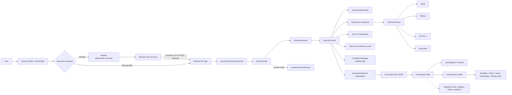

# CodeSight Technical Interview Guide

This report is based on the source currently in the repository. It distinguishes implemented behavior from product claims and recommended future work.

## 1. Project overview

CodeSight is an Electron desktop workspace with a React/Vite renderer, an Express execution API, local compiler/interpreter integration, and a playback-oriented visualization layer. The user edits source in Monaco, submits code plus language and optional stdin, receives an `ExecutionTrace`, and scrubs through normalized execution steps.

The important architectural fact is that execution and visualization are related but separate:

- JavaScript and Python have runtime-aware tracing paths for suitable programs.
- C, C++, and Java execute through real local toolchains, but their trace is a lightweight source walkthrough, not debugger instrumentation.
- A generic materializer supplies fallback frames when the specialized tracer produces no usable frames.
- The memory UI reconstructs stack/heap-like teaching models from serialized snapshots. It does not expose operating-system memory addresses or a complete native runtime heap.

## 2. Architecture diagram



## 3. Repository structure

| Area | Important files | Responsibility |
|---|---|---|
| Root | `package.json`, `README.md`, `render.yaml`, `vercel.json` | Workspace scripts, packaging, deployment metadata, high-level claims |
| Electron | `electron/main.ts` | BrowserWindow, embedded backend, menus, desktop file APIs, IPC handlers, logging, updates |
| Electron | `electron/preload.ts` | Narrow context-bridge API; execution, storage, file, update, and event subscriptions |
| Backend bootstrap | `backend/src/index.ts`, `app.ts` | Public Express API startup and middleware |
| Backend executor | `executorIndex.ts`, `executorApp.ts` | Secret-protected internal executor service for remote deployments |
| API | `routes/executionRoutes.ts`, `controllers/executionController.ts` | `POST /execute`, validation, error response envelope |
| Execution | `services/executeService.ts`, `executors/localExecutor.ts` | Queueing, provider selection, temporary files, compilation, process execution, trace orchestration |
| Process controls | `executors/runCommandWithLimits.ts`, `executionQueue.ts` | Spawn, stdin/stdout/stderr, timeouts, output caps, process-tree termination, concurrency |
| Runtime discovery | `executors/runtimeCatalog.ts`, `services/runtimeManagerService.ts` | Candidate commands, version probes, cached runtime status |
| Trace | `services/execution/javascriptTraceService.ts`, `pythonTraceService.ts`, `compiledTraceService.ts`, `traceFrameService.ts` | Specialized tracing and normalization/fallback |
| Trace contract | `backend/src/types/execution.ts` and mirrored `frontend/src/engine/types.ts` | Trace, frame, phase, diagnostic, mode, and memory DTOs |
| Frontend entry | `frontend/src/main.tsx`, `App.tsx`, `pages/HomePage.tsx` | React bootstrap, auth routing, workspace state, execution orchestration |
| Frontend visualization | `visualization/`, `memory/`, `components/` | Classroom frame model, diffs, stack/heap/arrays, timeline, editor decorations |
| Frontend local engine | `frontend/src/engine/interpreter.ts` | A separate Acorn-based renderer-side interpreter; useful as an architectural fallback/legacy path, but the main HomePage execution request uses the backend API |
| Persistence | `frontend/src/services/*`, `frontend/src/lib/supabase.ts`, `supabase/migrations/*` | Auth, snippets, history, feedback, analytics, admin views |

## 4. Process and communication model

In development, the root `dev` script starts backend, frontend, Electron compilation/watch, and Electron. Vite serves the renderer, normally on port 5180; Express normally listens on port 4000.

In a packaged desktop build, Electron starts the compiled Express app in-process on `127.0.0.1:4010`, then loads the packaged frontend. The renderer has no direct Node filesystem or child-process access. It calls the preload bridge, which invokes `desktop:run-code` in the main process. `electron/main.ts` forwards the request to the local backend using `invokeBackend("/execute", payload)`.

The browser path bypasses Electron and uses `fetch(API_BASE_URL + "/execute")`. This is why CORS exists in `backend/src/app.ts`.

Electron IPC is used for privileged desktop operations: local file open/save, local snippets, encrypted auth storage, window controls, updates, menu actions, and logs. Execution itself is IPC only for the desktop bridge; the actual execution API is HTTP inside the desktop process boundary.

## 5. Frontend architecture

`main.tsx` mounts `App` under `React.StrictMode`, `HashRouter`, and `AuthProvider`. `App.tsx` gates the authenticated workspace and lazy-loads home/admin routes.

`HomePage.tsx` is the main orchestration component. Important state includes:

- `language`, `title`, `code`, and `programInput` for the editor request.
- `trace` for the returned execution DTO.
- `currentStepIndex` for playback position.
- `isExecuting`, `isSaving`, and runtime-health state for status UI.
- workspace, snippet, history, theme, focus, and desktop-file state.

`CodeEditorPane` wraps `@monaco-editor/react`. On mount, HomePage keeps Monaco editor/monaco references, creates a decoration collection, and uses `syncEditorToLine` to set the cursor, reveal the active line, and center it near viewport edges. A runtime diagnostic with a line/column becomes a Monaco marker.

The page derives `playbackFrames` from `trace.traceFrames` or `trace.steps`, then derives `activeStep` and `previousStep`. `createExecutionClassroomFrame` combines the current step, previous step, code lines, language, and trace status into the presentation model used by `ExecutionVisualizer`, `VisualizationPanel`, memory views, and timeline components.

Playback is client-side. `usePlayback` uses `requestAnimationFrame`, advances after a configurable duration, and stops at the last frame. Previous/Next clamp `currentStepIndex`; they do not re-execute the program.

## 6. Actual execution lifecycle

The real call chain is:

```text
Run button / desktop menu
  -> HomePage.runCode()
  -> executeCodeRequest(code, language, programInput)
  -> window.electronAPI.runCode(...) [desktop]
  -> ipcRenderer.invoke("desktop:run-code")
  -> Electron main handler
  -> invokeBackend("/execute", payload)
  -> Express POST /execute
  -> executionController.execute()
  -> executeCode()
  -> executeCodeDirect() unless EXECUTOR_MODE=remote
  -> ExecutionQueue.enqueue()
  -> executeLocally()
  -> language-specific local executor
  -> runCommandWithLimits() for real runtime/compile phases
  -> language-specific trace generator
  -> materializeTraceFrames()
  -> finalizeTrace()
  -> JSON response
  -> HomePage.normalizeTracePayload()
  -> setTrace(), setCurrentStepIndex(0)
  -> classroom/visualization models and Monaco effects rerender
```

### Request and validation

`executionController.execute` converts `request.body.code`, `.language`, and `.stdin` to strings, rejects empty code with HTTP 400, normalizes language to lowercase, and checks `isSupportedLanguage`. Supported values are `javascript`, `python`, `c`, `cpp`, and `java`.

The API has a 1 MB JSON body limit by default, CORS allow-listing from `FRONTEND_URL`, Helmet, compression, structured request logging, and a rate limiter on `/execute` (60 requests per minute by default). The controller returns the structured trace even for many execution failures, so the frontend can display phase diagnostics.

### Runtime selection and workspaces

`localExecutor.ts` creates a random temporary directory under the OS temp directory and writes source there. Java has special layout detection: it searches for a package and class containing `main`, writes the matching class filename, compiles with `javac`, and runs the fully qualified class name when needed.

Runtime candidates are tried in order and can be overridden with environment variables (`NODE_EXECUTABLE`, `PYTHON_EXECUTABLE`, `GCC_EXECUTABLE`, `GPP_EXECUTABLE`, `JAVAC_EXECUTABLE`, `JAVA_EXECUTABLE`, and `JAVA_HOME`). Workspaces are removed in `finally` blocks using `removeDirectory`.

### JavaScript

The real run phase writes `main.js` and spawns Node with memory and stack flags. stdin is streamed to the process. If the mode plan allows full tracing, `executeJavaScript` parses and evaluates a supported subset with Acorn in `javascriptTraceService.ts`; it does not attach a debugger to the Node process. If tracing is skipped, the real output remains available and `traceFrameService` can produce a simplified fallback from source/output.

### Python

The run phase spawns Python against `main.py`. The trace phase creates another temporary runner containing base64-encoded user code/input. That generated Python uses `sys.settrace` and records line and return events for the user filename `<codesight>`. It serializes local/global scope with `repr`, walks the Python frame chain for stack snapshots, captures redirected console output, and emits JSON. The backend parses the result and converts it into timeline steps.

This is runtime-aware tracing, but only for the trace subprocess and only up to the configured step limit. It is not a full debugger protocol and values are string representations.

### C and C++

The source is compiled in the temporary directory with GCC/G++ and `-O2`, `-pipe`, and C11/C++17 settings. The output executable is then spawned. If full trace mode is selected, `createCompiledLanguageWalkthrough` parses simple function signatures/statements and simulates contexts, primitive/array values, aliases, loops, calls, and output association. It does not instrument the binary, use DWARF, GDB, LLDB, or observe native memory.

### Java

Java is compiled with `javac -encoding UTF-8` and run with `java`, a bounded heap flag, stack flag, classpath, and UTF-8 encoding. The same compiled-language walkthrough strategy is used for an eligible program.

### Child-process safety

`runCommandWithLimits` uses `spawn` with pipes, UTF-8 output, an execution timeout, and an aggregate stdout/stderr output limit. On timeout or output overflow it asks the child to terminate, then force-kills its process tree after 750 ms (`taskkill /T /F` on Windows or process-group kill on POSIX). It records exit code, signal, duration, timeout, and truncation.

The queue limits active executions and pending depth. These are reliability controls, not a security sandbox: local code still runs with the backend user's operating-system permissions.

## 7. Trace data model

`ExecutionTrace` contains IDs, timestamps, status, output, phase results, mode selection, limits, metrics, diagnostics, logs, stdin summary, `steps`, and `traceFrames`. An `ExecutionStep` may contain:

```ts
{
  line: number,
  description: string,
  explanation?: string,
  variables: [{ name, scope, value }],
  variablesBefore?: VariableSnapshot[],
  variablesAfter?: VariableSnapshot[],
  changedVariables?: [{ name, scope, before, after }],
  stack?: [{ name, locals: VariableSnapshot[] }],
  heap?: [{ id, label, type, value, scope }],
  output: string[],
  stdout?: string[],
  functionCalls?: FunctionCallSnapshot[],
  activeScopes?: ScopeSnapshot[],
  memoryChanges?: MemoryChange[],
  traceSource?: string,
  traceQuality?: "full" | "fallback" | "empty"
}
```

The actual backend type permits additional fields such as `frameId`, `eventType`, `lineNumber`, `codeLine`, `stackFrames`, and `heapState`. `materializeTraceFrames` normalizes missing values, adds code-line context, groups variables by scope, builds fallback stack/heap records, compares adjacent snapshots, and sets trace quality/source metadata.

A representative conceptual frame produced by the implementation is:

```json
{
  "line": 2,
  "description": "Declared count = 10",
  "variables": [{"name":"count","scope":"global","value":"10"}],
  "stack": [{"name":"global","locals":[{"name":"count","scope":"global","value":"10"}]}],
  "heap": [],
  "output": [],
  "changedVariables": [{"name":"count","scope":"global","after":"10"}],
  "traceQuality": "full"
}
```

The exact descriptions vary by tracer; the important contract is serialized snapshots, not native addresses.

## 8. How variable changes and memory visualization work

For `let count = 10; count = 20;`, a specialized tracer captures one step after declaration and another after assignment. `traceFrameService` keys variables by `scope:name` and compares the previous string value with the current string value. A mismatch becomes a `MemoryChange`/`ChangedVariable` with `before` and `after` values.

On the frontend, `compareExecutionFrames` and `diffMemoryModels` repeat this adjacent-frame comparison. `createVisualizationModel` parses serialized primitive, array, and object-like strings. Composite values become visual heap nodes; numeric variables with pointer-like names may be interpreted as array indices by the teaching model. `buildMemoryVisualizationModel` turns snapshots into stack frames and heap blocks, and components render emphasis for added/updated/removed items.

Therefore:

- Actual runtime memory: not exposed. The backend does not read OS addresses or inspect a live native heap.
- Debugger-provided state: not used for C/C++/Java; no GDB/LLDB/JDI integration is present.
- Instrumented/runtime state: Python uses `sys.settrace`; JavaScript uses a custom interpreter; these provide reconstructed variable/frame state.
- Simulated state: compiled-language walkthroughs and frontend heap models are simplified educational models.
- Static/fallback state: `traceFrameService` recognizes executable/output lines with regular expressions and creates fallback snapshots when specialized frames are missing.

Recursion is strongest in the Python tracer, which walks real Python frames, and in the JavaScript interpreter, which pushes a scope for user functions. Compiled-language recursion is only represented if the source walkthrough recognizes the function/call pattern. Heap allocation/deallocation is not a general native allocation trace; composite serialized values and walkthrough events are rendered as teaching blocks.

## 9. Execution modes

`createExecutionModePlan` does source-text complexity analysis: line/character count, loops, branches, imports, async signals, classes, recursion patterns, advanced library constructs, and stdin presence.

| Mode | Selection | Trace behavior |
|---|---|---|
| `trace` | Small/simple program | Full specialized tracer or compiled walkthrough, with a step cap |
| `safe` | JavaScript async/module/stdin, medium Python, or moderately complex compiled code | Real execution is prioritized; tracing may be skipped or capped |
| `performance` | Large/dense/complex source | Real compile/run is prioritized and trace is skipped |

Trace strategy is separately `full`, `best_effort`, or `skipped`. Python medium complexity can use `safe` plus `best_effort`; JavaScript async, module, and stdin cases explicitly skip the lightweight tracer. A successful run can therefore have zero frames, and a trace failure does not necessarily mean program execution failed.

## 10. API documentation

### `GET /health`

Returns `{ status, service: "api", executorMode, executionProvider, runtimeManager }`. It primes/reads the cached runtime probes.

### `GET /runtimes?refresh=1`

Returns runtime groups and command-level status for Node, Python, Java/Javac, GCC, and G++.

### `POST /execute`

Request:

```json
{"code":"print(1)","language":"python","stdin":""}
```

Success and execution-failure responses are normally an `ExecutionTrace`. Empty code or unsupported language returns HTTP 400. Unexpected controller failures are returned as an `internal_error` trace. In remote executor deployments, the public service calls `remoteExecutorService`, which posts to the secret-protected executor service's `/internal/execute` endpoint.

## 11. Error handling and observability

Phase results distinguish `compile`, `run`, and `trace`, including status, command, stdout, stderr, exit code, signal, duration, timeout, output limit, and failure category. `executionDiagnostics.ts` classifies compiler/runtime/timeout/memory/trace/internal outcomes and extracts useful source locations where possible.

The UI renders runtime state, diagnostics, output, and Monaco markers. Structured logs carry execution/trace IDs, language, phase, command, duration, and outputs. Electron forwards system-log events to the renderer and writes desktop startup logs. Supabase analytics/history is separate from the execution response and may record completed/failed activity.

## 12. Security considerations

Implemented controls include context isolation through a preload bridge, no renderer direct Node API, localhost binding for the packaged backend, CORS configuration, Helmet, body size limit, rate limiting, output limits, timeouts, queue limits, temporary workspace cleanup, and a shared secret for the internal remote executor.

Important limitations:

- Local user code is intentionally executed with the backend account's privileges; this is not a hostile-code sandbox.
- The compiler/interpreter can access whatever the local runtime permits unless OS/container isolation is added.
- `contentSecurityPolicy` is disabled in the Express Helmet configuration.
- Memory and CPU fields are part of the execution contract, but the shown process runner enforces timeout/output limits directly; it does not implement a complete cross-platform cgroup/job-object resource sandbox.
- Remote execution requires deployment-level isolation, authentication, quotas, and network restrictions beyond the shared HTTP secret.

## 13. Technical challenges and interview framing

### Multiple languages

Problem: compilers, interpreters, file naming, stdin, diagnostics, and runtime discovery differ.

Solution: language configs, candidate commands, a common phase/trace DTO, and separate language executors.

Trade-off: the common interface hides meaningful language-specific limitations; tracing fidelity differs by language.

Interview answer: “I normalized the execution contract around compile/run/trace phases, while keeping language adapters responsible for toolchain details.”

### Execution versus visualization

Problem: a program can execute correctly without a safe or accurate pedagogical trace.

Solution: mode planning, specialized tracers, caps, and fallback materialization.

Trade-off: some complex programs show output but few/no frames.

Interview answer: “I treat trace generation as a second pipeline with its own failure state, so a trace limitation does not misreport a successful runtime execution.”

### Process termination

Problem: infinite loops, blocked input, runaway output, and child descendants.

Solution: timeout, output cap, graceful termination followed by process-tree kill, and queue limits.

Trade-off: force-killing can lose final output and is platform-specific.

### Runtime availability

Problem: desktop users may not have Node/Python/JDK/GCC or may have Windows aliases.

Solution: startup/runtime endpoint probes, candidate fallback commands, Java home support, and diagnostics/guidance in the UI.

Trade-off: probes can become stale and “installed” does not guarantee a compatible compiler.

### Memory visualization accuracy

Problem: source languages have different memory models and native addresses cannot be safely inferred from output.

Solution: serialized snapshots, scopes, stack-like frames, composite heap blocks, adjacent-frame diffs, and explicit trace quality.

Trade-off: the visualization is educational/reconstructed, not a native debugger.

### Synchronizing React and Monaco

Problem: playback state drives many components and editor scrolling can be janky.

Solution: one `currentStepIndex`, derived classroom frame, decoration collection, and `requestAnimationFrame` reveal scheduling.

Trade-off: HomePage is a large orchestration component and could be decomposed further.

### Remote/deployment architecture

Problem: public API and execution workers need different trust boundaries.

Solution: `EXECUTOR_MODE=remote`, internal executor app, shared secret, and remote timeout.

Trade-off: the repository does not provide a complete multi-tenant sandbox or distributed job system.

## 14. Interview explanations

### 30-second introduction

“CodeSight is an Electron and React workspace for learning how programs execute. Users edit JavaScript, Python, C, C++, or Java in Monaco, run them with locally installed runtimes, and inspect a timeline of source lines, variables, scopes, output, and reconstructed stack/heap views. The backend separates compile, run, and trace phases, applies process limits, and returns a typed execution trace that the frontend replays.”

### Two-minute explanation

“The renderer owns the editor and playback state. On Run it sends source, language, and stdin through the Electron preload bridge on desktop, or directly to the Express API in a browser. Electron embeds the backend in packaged builds. The controller validates the request, the execution service queues it, and the local executor selects a language adapter. C, C++, and Java compile in a temporary directory before running; JavaScript and Python run through Node/Python. Each child process has timeout and output limits and is cleaned up afterward.

Tracing is deliberately separate from execution. Small JavaScript programs are evaluated by an Acorn-based educational interpreter, Python uses a generated `sys.settrace` runner, and compiled languages use a source walkthrough. A complexity planner can skip tracing for async, large, or risky programs while preserving real output. The result is normalized into `ExecutionStep` snapshots. HomePage selects one frame by index; derived models compare it with the previous frame and update the timeline, Monaco line highlight, explanation, variables, stack, and heap panels.”

### Five-minute deep explanation

Explain the diagram, then emphasize: transport, validation, queue, temporary workspace, phase-specific child processes, runtime detection, mode selection, trace fidelity, `ExecutionTrace`, adjacent-frame diffing, and the security boundary. State explicitly that local execution is not sandboxed and that memory diagrams are reconstructed teaching models rather than native memory inspection.

## 15. Fifty interview questions and answers

1. **Why Electron?** It packages a native desktop shell with a local backend and filesystem/runtime access while keeping the UI web-based. The trade-off is larger footprint and a privileged main process.
2. **What is the renderer/main-process boundary?** React runs in the renderer; privileged IPC handlers run in Electron main; preload exposes only selected functions.
3. **Why preload?** It preserves context isolation and avoids giving arbitrary renderer JavaScript Node access.
4. **How does Run reach the backend?** `HomePage.runCode` -> `executeCodeRequest` -> `electronAPI.runCode` -> main IPC handler -> localhost `/execute`.
5. **What is the browser path?** `executeCodeRequest` uses `fetch` to `API_BASE_URL/execute` when Electron is unavailable.
6. **How is language validated?** The controller lowercases the field and checks `supportedLanguages`.
7. **How are C/C++ executed?** Write source, spawn GCC/G++, check compile phase, then spawn the generated executable.
8. **How is Java executed?** Detect class/package layout, write matching file, run `javac`, then `java -cp` with the qualified class.
9. **How is Python traced?** A generated runner uses `sys.settrace`, serializes scope/frame chains, redirects output, and emits JSON steps.
10. **How is JavaScript traced?** Acorn parses a supported subset and `StepInterpreter` evaluates statements while capturing state.
11. **Is Node debugger used?** No. The real Node process executes code; the educational JavaScript tracer is separate.
12. **Is GDB used?** No. C/C++/Java use a heuristic walkthrough, not binary debugger data.
13. **What is an execution phase?** Compile, run, or trace, each with independent status and diagnostics.
14. **What happens on compiler error?** Compile phase records stderr/exit code, trace is skipped, diagnostics classify it as compile failure, and a trace envelope returns.
15. **How are missing runtimes handled?** Candidate commands are tried; ENOENT/EACCES and known Python Store alias output become runtime-missing diagnostics.
16. **How are infinite loops handled?** Timers terminate the process and then force-kill its process tree.
17. **How is output bounded?** stdout and stderr byte counts share an aggregate cap; overflow terminates the child.
18. **How is stdin handled?** It is written to the child's stdin and then closed; a summary is also stored in the trace.
19. **Why use a queue?** To cap concurrent local processes and avoid resource spikes.
20. **What is the queue trade-off?** Requests wait or fail when full; it is not a durable job queue.
21. **How is a temporary workspace cleaned?** Each language executor removes it in a `finally` block.
22. **What if cleanup fails?** The cleanup helper is best effort; a production hardening item is a janitor and disk quota.
23. **What does `ExecutionTrace` provide?** IDs, frames, output, phases, mode, limits, metrics, diagnostics, logs, and status.
24. **How does line highlighting work?** The active frame line drives Monaco decoration and a scheduled reveal/scroll operation.
25. **How does Next work?** It increments `currentStepIndex`; all views derive from the new frame.
26. **How does Play work?** `usePlayback` advances the same index with `requestAnimationFrame` until the last frame.
27. **How are previous values found?** The current step is compared against the immediately previous step by `scope:name`.
28. **How is a variable update detected?** Stringified snapshot values differ for the same scoped variable key.
29. **How is recursion visualized?** Runtime Python frame chains and JavaScript interpreter scopes produce nested stack snapshots; compiled tracing is heuristic.
30. **Is heap data real?** No. Arrays/objects are serialized values represented as UI heap blocks.
31. **How are references represented?** The frontend uses teaching heuristics, including pointer-like names and array indices; it is not a universal reference map.
32. **What is fallback tracing?** Regex-based executable-line recognition plus snapshots/output when specialized tracing is unavailable.
33. **Why can a successful run have no frames?** The mode plan can skip tracing, or a trace can fail after run succeeds.
34. **Why cap trace steps?** To prevent loops/recursion from making the UI or trace subprocess unbounded.
35. **How are modes chosen?** Source-text complexity signals determine trace, safe, or performance mode.
36. **What is a weakness of that selection?** Regex complexity is approximate and can misclassify valid or unusual syntax.
37. **How does C++ differ from C?** Toolchain flags and walkthrough language patterns differ; both share compile/run phase infrastructure.
38. **How does JavaScript stdin affect tracing?** The plan selects safe mode and skips the lightweight tracer because input replay is not implemented there.
39. **How is runtime health shown?** `/health` and `/runtimes` expose cached command probes rendered by RuntimeManagerPanel.
40. **Why cache probes?** Startup/UI refresh avoids repeatedly spawning version commands; explicit refresh invalidates the cache path.
41. **What security controls exist?** Context isolation, narrow preload, CORS, Helmet, rate/body/output/time limits, queueing, and remote shared-secret protection.
42. **Is execution secure against malicious code?** Not sufficiently for hostile multi-tenant use; local processes retain OS privileges.
43. **How would you harden it?** Run isolated containers/VMs or OS sandboxes with no network, read-only mounts, quotas, job objects/cgroups, and a worker broker.
44. **Why Express?** It provides a small HTTP layer for health, runtime, and execution endpoints and is easy to embed in Electron.
45. **Why TypeScript?** Shared DTOs and discriminated statuses reduce mismatches across Electron, backend, and frontend.
46. **Why Monaco?** It supplies language-aware editing, diagnostics markers, decorations, and editor APIs suited to a code-learning product.
47. **What is the biggest architectural limitation?** Trace fidelity is inconsistent: Python/JS specialized paths differ from compiled heuristic walkthroughs.
48. **How would you support 10,000 users?** Move execution to isolated workers, use a durable queue, quotas, result storage, autoscaling, and per-user authorization.
49. **What would you improve in one month?** Add a defined sandbox, tests for each language/mode, stronger AST/debugger tracing, and split HomePage orchestration.
50. **How would you explain the memory model honestly?** “We visualize serialized runtime snapshots and reconstructed educational heap/stack models; we do not claim to expose actual OS memory.”

## 16. Technology choices

| Technology | Role | Reason/alternative |
|---|---|---|
| Electron | Desktop shell, IPC, filesystem, embedded server | Faster reuse of web UI; alternatives include Tauri or native UI |
| React | Component/state rendering | Good derived-view model; alternatives include Vue/Svelte |
| Vite | Dev server and frontend build | Fast iteration; alternatives include Webpack/Parcel |
| Monaco | Editor, markers, decorations, scrolling | VS Code-grade editor; CodeMirror is lighter |
| Node.js | Backend and JavaScript runtime | Same ecosystem and child-process APIs; alternatives include Rust/Go backend |
| TypeScript | Cross-layer contracts | Catches DTO/state errors; alternatives are runtime schemas plus JavaScript |
| Express | HTTP API and embedded server | Small and familiar; Fastify can provide higher throughput/schema support |
| Child processes | Execute local language tools | Direct local integration; containers/VMs are safer isolation |
| Acorn | JavaScript parsing | Lightweight AST parser; Babel parser is broader but heavier |
| Python `sys.settrace` | Python line/return tracing | Built-in runtime hook; debugger APIs or bytecode instrumentation could be richer |
| C/C++ | User-supported compiled languages | GCC/G++ are widely available; clang could add portability |
| Java | User-supported JVM language | `javac/java` are standard; JDI could improve tracing |
| Supabase | Auth, snippets, history, analytics/admin data | Managed Postgres/auth; a custom backend could centralize policy |

The README mentions React Query, but the inspected frontend uses direct service functions and `fetch`/Supabase calls rather than a visible React Query integration. That is an example of documentation drift worth mentioning in an interview.

## 17. Verification performed

- `npm run build --prefix backend`: passed TypeScript compilation.
- `npm run verify:engine --prefix backend`: passed the repository checks for JavaScript recursion with stdin and C arrays/pointers. The output reported JavaScript `safe/skipped`, 6 fallback frames, and C `trace/full`, 11 full frames.
- Frontend and Electron TypeScript build commands were started but did not return a completion result within the available command window; no success claim is made here.

## 18. Limitations and future improvements

1. Add integration tests for every language, compile failure, missing runtime, timeout, output cap, stdin, recursion, and cleanup path.
2. Replace heuristic compiled walkthroughs with debugger/agent-based instrumentation where safe and portable.
3. Define a real sandbox boundary before accepting hostile or multi-user code.
4. Use runtime schemas (for example, Zod or JSON Schema) at the API boundary in addition to TypeScript types.
5. Split `HomePage.tsx` into editor, execution, workspace, playback, and persistence controllers/hooks.
6. Add trace provenance to every frame so the UI can explain exactly whether it came from Python tracing, JS interpretation, compiled walkthrough, or fallback materialization.
7. Implement stronger heap/reference semantics and distinguish aliasing from merely equal serialized values.
8. Add durable remote execution jobs, cancellation, quotas, worker health, and result retention for scale.
9. Add a cleanup janitor and disk quotas for abandoned temporary directories.
10. Enable and review a strict content security policy where compatible with the desktop/browser deployment.

## 19. Glossary

- **Execution phase:** Compile, run, or trace stage of a request.
- **Execution trace:** The complete response envelope, including steps and diagnostics.
- **Execution step/frame:** One serialized teaching snapshot associated with a source line.
- **Trace materialization:** Normalizing specialized or fallback data into the common frame contract.
- **Fallback trace:** Simplified source/output-based visualization when full tracing is unavailable.
- **Mode plan:** Complexity-based decision about trace/safe/performance behavior.
- **Scope:** A named variable environment such as global or a function.
- **Stack snapshot:** A reconstructed list of active scopes and locals.
- **Heap snapshot:** A reconstructed list of composite values represented as UI nodes.
- **Runtime probe:** A version command used to detect an installed toolchain.
- **Execution queue:** In-memory concurrency/depth limiter for requests.
- **Process tree termination:** Killing a child and descendants after timeout or output overflow.
- **IPC:** Electron's inter-process communication between renderer and main.
- **Context bridge:** The preload-exposed, allow-listed renderer API.
- **Instrumentation:** Capturing state from the executing runtime, as Python's `sys.settrace` does.
- **Simulated memory:** A reconstructed model designed for explanation, not physical memory inspection.
