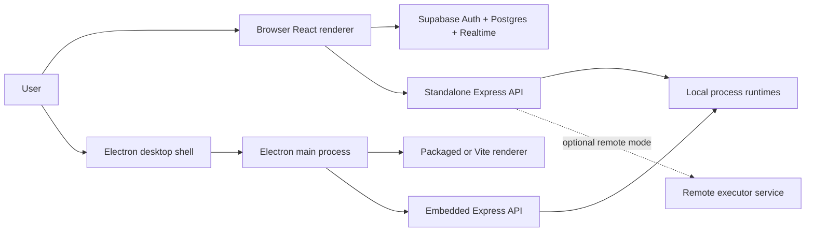
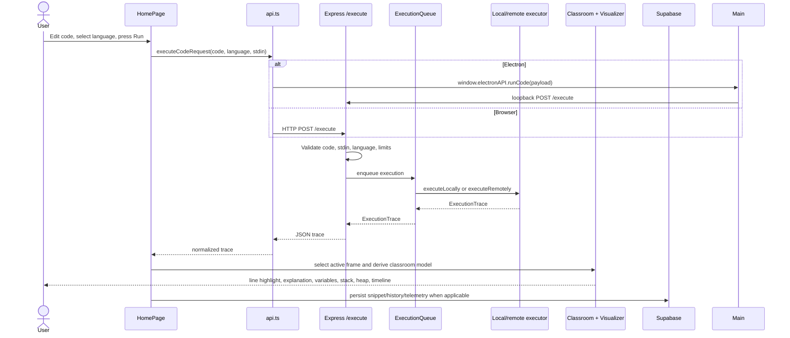
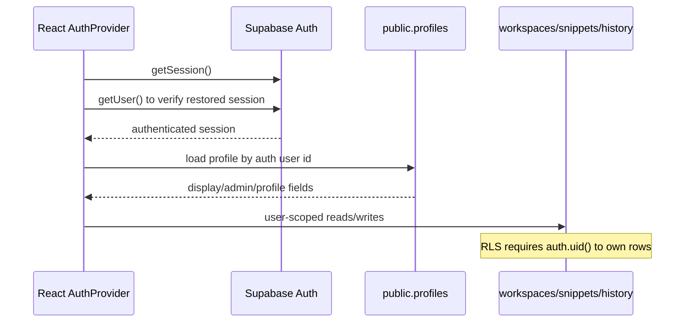
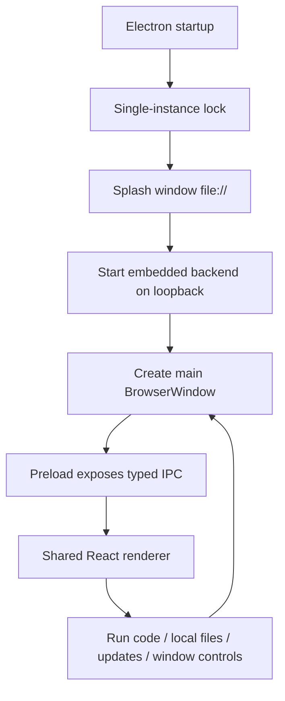

# AlgoLoom / CodeSight Current Architecture

## System context

The browser and desktop applications share the React renderer. Electron adds a main process and preload bridge; it does not replace the frontend architecture.

## Frontend execution workflow

### Backend execution details

1. `executionController` converts request fields to strings and rejects empty code, oversized code/stdin, and unsupported languages.
2. `executeService` selects `remote` mode when configured; otherwise it uses an in-memory `ExecutionQueue` and `executeLocally`.
3. `localExecutor` creates a temporary workspace, runs compile/run phases for C, C++, and Java, and runs interpreter processes for JavaScript/Python.
4. JavaScript uses an Acorn-backed educational interpreter for eligible small programs. Complex, async, module, or stdin-driven JavaScript is executed safely but may skip tracing.
5. Python creates a temporary tracing runner using `sys.settrace`, serializing line steps, scope values, stack frames, output, and errors.
6. C/C++/Java use normal local compilation/execution and then a source-oriented `compiledTraceService` walkthrough. This is not a native debugger trace; it is a bounded heuristic interpreter over supported source constructs.
7. `traceFrameService` materializes trace frames and `runtimeTrace` adds phase status, diagnostics, limits, logs, and metrics.
8. The frontend normalizes legacy `steps` and current `traceFrames`, then `createExecutionClassroomFrame` derives explanations and memory models.

## Frontend state and visualization

`HomePage` is currently the main orchestration boundary. It owns code, language, title, stdin, trace, current frame, snippets, history, runtime health, theme, desktop-file state, and notices.

- Monaco is mounted by `CodeEditorPane` and synchronized with the active execution line.
- `usePlayback` advances frame indices with `requestAnimationFrame`.
- `PlaybackDock`, `TimelineScrubber`, and related controls update the current frame.
- `executionClassroom.ts` creates line explanations, runtime summaries, variable changes, stack entries, and trace-quality labels.
- `visualization/model.ts` and memory utilities derive arrays, pointers, heap nodes, and diffs.
- `ExecutionVisualizer` renders explanation, variables, stack, and heap tabs.

## Authentication and Supabase workflow

Supabase Auth is the identity source. Database triggers provision/update `profiles`, `user_settings`, and a default workspace. Frontend services call Supabase directly and use `requireSessionUserId` to verify the active session before user-data operations. Admin pages query telemetry tables after `useAdminAccess` confirms `profiles.is_admin = true`.

## Persistence workflows

- Workspace list/default workspace: `workspaceService` → `workspaces`.
- Snippet create/list/load/update/delete: `snippetService` → `snippets`, scoped by user and workspace.
- Execution history: `historyService` validates snippet ownership, then writes immutable execution history records.
- Preferences: `userSettingsService` → `user_settings`.
- Product telemetry: `analyticsService` writes `user_activity`, `execution_logs`, `visualization_sessions`, crash reports, and feedback.
- Admin: `adminService` reads telemetry and profiles, subscribes to Supabase Realtime changes, and exports CSV/JSON client-side.

## Desktop workflow

The main process validates trusted IPC senders, restricts navigation, disables Node integration, uses context isolation/sandboxing, stores local snippets under Electron user data, and manages auto-update state. The renderer can use HTTP directly in a browser or the IPC `runCode` path in Electron.

## API surface found

| Method | Path | Purpose | Auth model |
|---|---|---|---|
| GET | `/live` | Process liveness | None |
| GET | `/ready` | Runtime readiness | None |
| GET | `/health` | API and runtime-manager health | None |
| GET | `/runtimes` | Runtime detection, optional refresh | None |
| POST | `/execute` | Code execution and trace generation | No Supabase auth; rate/size/queue limits |

The application data API is Supabase REST/Realtime accessed by the frontend; there is no separate Express CRUD API for users, snippets, workspaces, or analytics.

