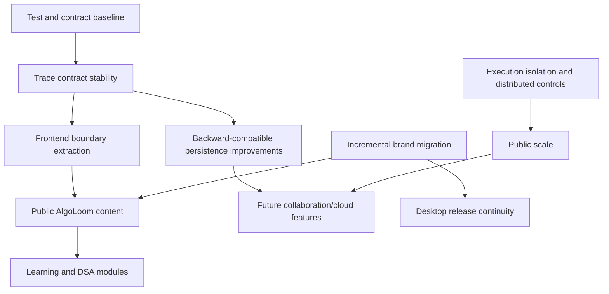

# Implementation Risks and Recommended Order

## Risk register

| Risk | Severity | Evidence/impact | Guardrail before feature work |
|---|---|---|---|
| No unit/integration/E2E test suites | High | Regression detection relies on builds and one engine verification script | Add focused tests around trace contracts, auth gates, persistence mappers, and execution API before broad changes. |
| `HomePage` is a large orchestration boundary | High | Editor, execution, persistence, telemetry, desktop events, playback, and UI state converge there | Refactor only behind tests and stable hooks/contracts; avoid parallel feature branches changing the same state blindly. |
| Local process execution is not a complete sandbox | High | User code runs with the host account’s OS capabilities | Treat local execution as trusted-user functionality; use isolated workers/containers for hostile multi-tenant execution. |
| Execution limits and rate limits are instance-local | High | Queue and limiter are in memory | Do not horizontally scale public execution without shared queue/limiter and isolated workers. |
| Compiled-language tracing is heuristic | High | `compiledTraceService` parses a restricted source subset after real execution | Label trace quality honestly; add fixture tests per language before promising debugger-level fidelity. |
| JavaScript/Python trace eligibility is conditional | Medium | Complexity analysis can select safe/performance mode or cap frames | Surface mode/quality in UX and test representative programs. |
| Browser execute endpoint has no application auth | High | `/execute` is protected by CORS, rate, size, queue, and timeout controls, not identity | Add abuse controls and authenticated quotas before offering expensive public execution at scale. |
| Frontend calls Supabase directly | Medium | CRUD and admin policy correctness depend on RLS/migrations | Treat migrations and generated types as versioned contracts; test policies in a staging project. |
| Admin access depends on `profiles.is_admin` | Medium | UI reads the profile row, not only `role` | Keep role/flag semantics consistent and provide an operational verification procedure. |
| Public SEO surface is an authenticated SPA shell | Medium | Root content varies between auth and workspace; no educational public routes | Add public routes/content deliberately, with SSR/prerender strategy if search visibility matters. |
| Client-side admin aggregation | Medium | Analytics fetches broad rows and computes metrics in browser | Add pagination/aggregation boundaries as data volume grows. |
| Dependency/security maintenance | Medium | Multiple package locks and runtime-sensitive packages | Audit each lockfile separately; update in controlled batches with builds and runtime verification. |
| Desktop/browser configuration drift | Medium | Same renderer uses HTTP in browser and IPC in Electron | Keep both paths in smoke tests; preserve IPC sender validation. |
| Runtime availability varies by host | Medium | Java/Python/GCC/Node are discovered at runtime | Keep runtime manager authoritative; do not assume all languages are available in CI or production. |

## Duplicate or tightly coupled areas

- Root, frontend, and backend each have package metadata/lockfiles; dependency ownership must remain explicit.
- Execution types exist in backend and frontend and must stay wire-compatible.
- `HomePage` and Electron main both contain execution orchestration decisions.
- Runtime configuration appears in backend language configs, runtime catalog, frontend language maps, and Electron payload types.
- SEO facts are duplicated between `frontend/index.html` and `frontend/src/seo.tsx`.
- Admin service mapping uses several `any`-typed database rows, reducing compile-time protection.

## Performance concerns

- Monaco and visualization libraries are large, although route/component lazy loading already reduces initial work.
- Trace snapshots can grow quickly; frame, output, and source limits exist but frontend rendering still processes complete traces.
- Admin analytics loads broad datasets and aggregates client-side.
- Runtime probing invokes several external commands and is cached, but readiness depends on host tools.
- Playback derives classroom/memory models on frame changes; large traces need profiling before adding richer visual layers.

## Recommended implementation order

1. Establish a test baseline: build, engine fixtures, API contract tests, Supabase policy/migration checks, and a minimal browser smoke test.
2. Freeze and document the execution trace contract and feature-quality semantics across all five languages.
3. Extract small, tested frontend domain hooks from `HomePage` only where a feature requires it.
4. Add the public AlgoLoom information architecture and visible educational content without changing the authenticated workbench route.
5. Add learning concepts, algorithm/data-structure modules, and practical developer tools as independently testable routes/features.
6. Improve persistence/workspace capabilities with backward-compatible migrations and RLS tests.
7. Harden scale and execution isolation before increasing public execution traffic or adding collaboration.
8. Rename/rebrand incrementally, preserving CodeSight compatibility in package IDs, deployment paths, database records, and Electron update channels until migration is planned.

## Mermaid dependency view

## Explicit non-goals for this audit

No redesign, major refactoring, data migration, dependency upgrade, route change, or execution-engine replacement was performed. The four documents created in this stage are discovery artifacts only.

