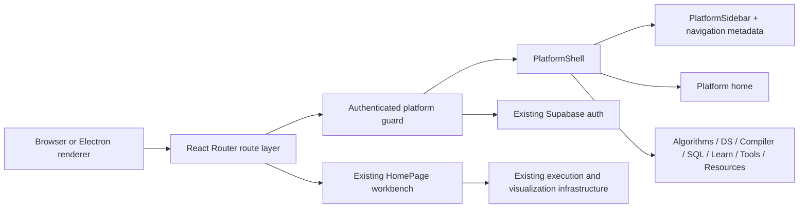

# AlgoLoom Platform Architecture

## Purpose

Prompt 4 establishes the platform shell and navigation foundation without rewriting the existing CodeSight workbench. AlgoLoom can now expose a coherent set of module entry points while each domain is implemented in a later, separately validated stage.

## Current route map

| Route | Module | Current state | Compatibility note |
| --- | --- | --- | --- |
| `/` | Existing workspace/auth entry | Working | Preserved as the existing desktop/web entry point. |
| `/playground` | Playground | Working | Reuses the existing `HomePage`, execution engine, tracing, visualizations, history, and workspace flows. |
| `/home` | Platform home | Foundation | Overview and link to the existing Playground. |
| `/algorithms` | Algorithms | Foundation | Honest empty state; no fake algorithm execution. |
| `/data-structures` | Data Structures | Foundation | Honest empty state; no duplicate visualization engine. |
| `/compiler` | Compiler | Foundation | Reserved for a future supported-language compiler experience. |
| `/sql-lab` | SQL Lab | Foundation | Reserved for a future SQL execution adapter. |
| `/learn` | Learn | Working first slice | Public fundamentals lessons with local progress/bookmarks and optional signed-in quiz telemetry. |
| `/tools` | Developer Tools | Foundation | Reserved for independently scoped productivity utilities. |
| `/resources` | Blog & Resources | Foundation | Reserved for educational content and publishing workflows. |

All platform routes are authenticated and are marked `noindex,nofollow` by the existing SEO layer. Public marketing/SEO metadata remains attached to the root entry point.

## Shell and module boundaries

The shell owns platform-level concerns: navigation, responsive layout, breadcrumbs, and module framing. Module pages own domain content. The Playground remains a compatibility boundary around the existing workbench and is not duplicated inside the new module pages.

## Source boundaries

- `frontend/src/platform/navigation.ts`: the typed route/module catalog. New modules should be registered here before adding UI.
- `frontend/src/components/platform/PlatformSidebar.tsx`: responsive, keyboard-native navigation.
- `frontend/src/components/platform/PlatformShell.tsx`: shared authenticated frame, breadcrumbs, and outlet.
- `frontend/src/pages/platform/PlatformModulePage.tsx`: temporary foundation presentation for modules not yet implemented.
- `frontend/src/pages/HomePage.tsx`: existing playground/workbench. It remains the source of truth for execution and visualization behavior.
- `frontend/src/App.tsx`: route composition and authentication boundaries.

## Navigation behavior

- Desktop uses a persistent sidebar.
- Small screens use a toggleable navigation drawer with an accessible label and overlay.
- Each link is a native `NavLink`, so keyboard focus and current-route semantics remain browser/React Router behavior rather than custom click handling.
- Breadcrumbs identify the current module and link back to `/home`.
- “Open Playground” always leads to the existing workbench.
- Foundation modules have no non-functional action controls.

## Future implementation order

1. Add shared content/card primitives only where multiple modules need them.
2. Implement Algorithms and Data Structures using existing visualization and execution adapters.
3. Expand Learn content and move progress/bookmarks to a dedicated user-progress boundary for cross-device sync.
4. Add Compiler and SQL Lab only after runtime/security constraints and quotas are specified.
5. Add Developer Tools and Resources as independently scoped modules.
6. Add module-specific tests before enabling production workflows.

Each step should preserve the route contract and avoid moving execution logic into the shell.

## Compatibility and risks

- The root route remains unchanged to protect existing bookmarks and Electron behavior.
- `/playground` is an additive route and reuses the existing component; it does not create a second execution engine.
- Platform modules currently depend on the existing authenticated app shell and Supabase session state.
- The current browser test infrastructure is Node-based, so responsive navigation should receive browser/E2E coverage when that infrastructure is introduced.
- Future modules must define authorization, data ownership, rate limits, and failure states before connecting to execution or persistence services.
- The current Learn slice intentionally uses browser storage for progress/bookmarks because no learning-progress relation exists in the applied schema; signed-in quiz activity is recorded through the existing `user_activity` telemetry boundary.

